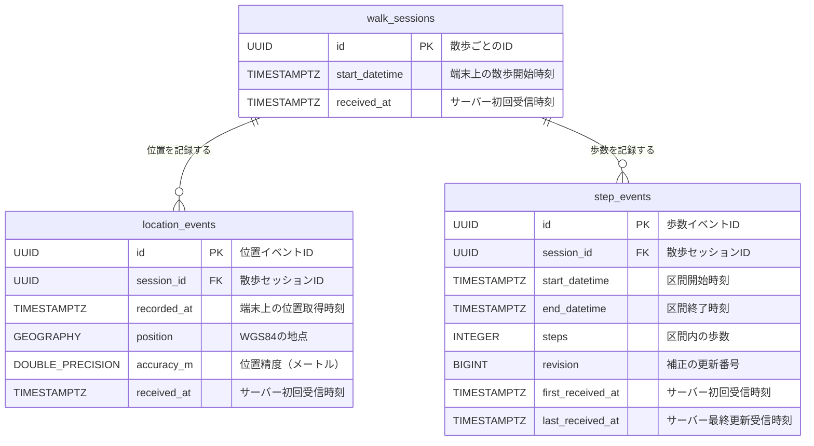

# DB定義

## 概要

散歩1回を `walk_sessions` で表し、その散歩中に取得した位置と歩数を
`location_events` と `step_events` に保存する。

端末で発生した時刻とサーバーが受信した時刻は別のカラムに保持する。
日時型にはすべて `TIMESTAMPTZ` を使用し、アプリケーションではUTCへ正規化する。

## ER図

`location_events.session_id` と `step_events.session_id` は、
`walk_sessions.id` を参照する。外部キーに `ON DELETE CASCADE` は設定していないため、
子レコードが残っているセッションの削除はDBが拒否する。

## `walk_sessions`

1回の散歩を表す親テーブル。`id` は端末ごとの固定IDではなく、散歩を開始するたびに
端末が生成するUUIDである。同じ端末から複数の散歩セッションが作成される。

| カラム | 型 | NULL | デフォルト | 説明 |
| --- | --- | --- | --- | --- |
| `id` | `UUID` | 不可 | なし | 散歩セッションID。主キー |
| `start_datetime` | `TIMESTAMPTZ` | 不可 | なし | 端末上で散歩を開始した時刻 |
| `received_at` | `TIMESTAMPTZ` | 不可 | `clock_timestamp()` | サーバーが初めて受信した時刻 |

同じID・同じ開始時刻の再送では行を変更しない。同じIDで異なる開始時刻を受信した場合は、
アプリケーションが競合として扱う。

## `location_events`

散歩中に端末が取得した位置を、1回の取得につき1行保存する。

| カラム | 型 | NULL | デフォルト | 説明 |
| --- | --- | --- | --- | --- |
| `id` | `UUID` | 不可 | なし | 位置イベントID。主キー |
| `session_id` | `UUID` | 不可 | なし | `walk_sessions.id` を参照する外部キー |
| `recorded_at` | `TIMESTAMPTZ` | 不可 | なし | 端末が位置を取得した時刻 |
| `position` | `GEOGRAPHY(Point, 4326)` | 不可 | なし | WGS84の地点。保存時は経度、緯度の順で組み立てる |
| `accuracy_m` | `DOUBLE PRECISION` | 不可 | なし | 位置精度。単位はメートル |
| `received_at` | `TIMESTAMPTZ` | 不可 | `clock_timestamp()` | サーバーが初めて受信した時刻 |

### 制約とインデックス

- `accuracy_m >= 0`
- `(session_id, recorded_at)` のB-tree index
  - セッション内の位置を時刻順に取得するときに使用する。
- `position` のGiST index
  - 距離検索や範囲検索などのPostGIS空間検索に使用する。

緯度、経度の範囲と、位置取得時刻がセッション開始以降であることは
アプリケーションでも検証する。同じID・同じ内容の再送では行を変更しない。

## `step_events`

セッション開始を起点に区切った、最大1分の歩数区間を保存する。
散歩終了時の最後の区間だけは1分未満にできる。

| カラム | 型 | NULL | デフォルト | 説明 |
| --- | --- | --- | --- | --- |
| `id` | `UUID` | 不可 | なし | 歩数イベントID。主キー |
| `session_id` | `UUID` | 不可 | なし | `walk_sessions.id` を参照する外部キー |
| `start_datetime` | `TIMESTAMPTZ` | 不可 | なし | 歩数区間の開始時刻 |
| `end_datetime` | `TIMESTAMPTZ` | 不可 | なし | 歩数区間の終了時刻 |
| `steps` | `INTEGER` | 不可 | なし | 区間内の歩数 |
| `revision` | `BIGINT` | 不可 | なし | 同一区間を補正するときの更新番号 |
| `first_received_at` | `TIMESTAMPTZ` | 不可 | `clock_timestamp()` | サーバーが初めて受信した時刻 |
| `last_received_at` | `TIMESTAMPTZ` | 不可 | `clock_timestamp()` | 最後に新しい補正を受信した時刻 |

### 制約

- `steps >= 0`
- `revision >= 1`
- `end_datetime > start_datetime`
- `end_datetime <= start_datetime + INTERVAL '1 minute'`
- `UNIQUE (session_id, start_datetime)`

区間開始がセッション開始から整数分後であることは、別テーブルの値との比較が必要なため
アプリケーションで検証する。

同一区間の補正では同じ行を更新する。保存済みより大きい `revision` だけを受け付け、
`steps`、`revision`、`last_received_at` を更新する。`id`、`session_id`、区間の開始・終了時刻、
`first_received_at` は変更しない。古い `revision` の再送は成功扱いで無視する。

## 定義の管理

実際のスキーマ定義は `db/migrations/` を正とする。定義を変更するときはmigration、
SQLC生成コード、この文書を同じ変更で更新する。
